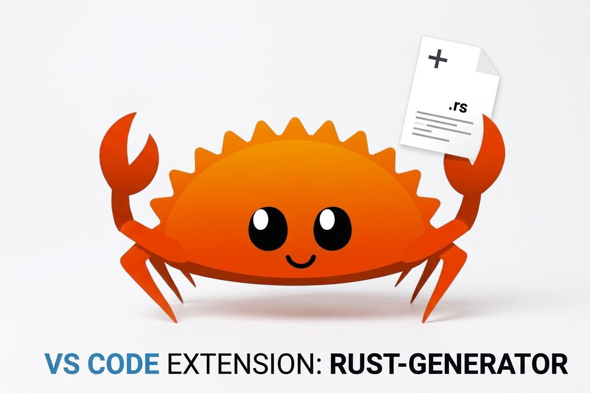
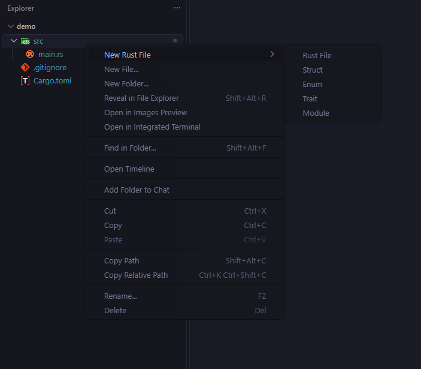
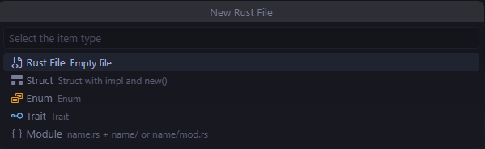
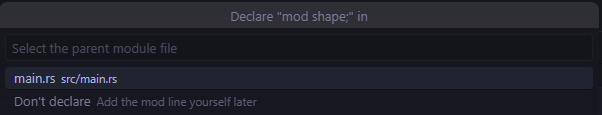
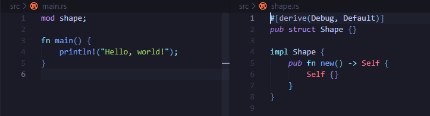

# Rust Generator

  

Create Rust files, structs, enums, traits, modules and build scripts directly from the VS Code explorer — no boilerplate typing.

🇫🇷 [Version française ↓](#version-fr)

## Features

Right-click a folder inside a Cargo project to get a **New Rust File** submenu:

- **Rust File** — an empty `.rs` file
- **Struct** — with `#[derive(Debug, Default)]` and a `new()` constructor
- **Enum** — with `#[derive(Debug)]`
- **Trait**
- **Module** — choose between the modern `name.rs` + `name/` layout or the classic `name/mod.rs`
- **Build Script** — a `build.rs` at the crate root (only shown there)

The keyboard shortcut `Ctrl+Shift+Alt+R` (`Cmd+Shift+Alt+R` on macOS) opens the same list of types, targeting the folder of the currently open file.

Both the explorer menu and the shortcut only appear inside a Cargo project (a folder containing a `Cargo.toml` with a `[package]` or `[workspace]` section).

## Screenshots

Right-click a folder in the explorer:

Or press `Ctrl+Shift+Alt+R` to pick the item type:

Choose where to declare the new module:

The file is created and declared:

## How it works

1. Pick a type.
2. Type a name — it is converted to `snake_case` for the file and `PascalCase` for the generated type, and validated live (Rust keywords and existing files are rejected).
3. For a module, pick the layout.
4. Pick which parent file should declare the new module (`mod name;`), among the ones that actually exist (`lib.rs`, `main.rs`, `mod.rs` or the folder's own `.rs` file) — or choose not to declare it.

Creating an item at the root of a crate is automatically redirected to its `src` folder.

## Requirements

No external dependency. Works in any Cargo project.

## License

[MIT](LICENSE)

[↑ Back to top](#rust-generator)

---

## Version FR

  

Crée des fichiers Rust, des struct, enum, trait, modules et scripts de build directement depuis l'explorateur de VS Code, sans taper le code répétitif à la main.

🇬🇧 [English version ↑](#rust-generator)

## Fonctionnalités

Un clic droit sur un dossier d'un projet Cargo fait apparaître un sous-menu **New Rust File** :

- **Rust File** : un fichier `.rs` vide
- **Struct** : avec `#[derive(Debug, Default)]` et un constructeur `new()`
- **Enum** : avec `#[derive(Debug)]`
- **Trait**
- **Module** : au choix, le style moderne `nom.rs` + `nom/`, ou le style classique `nom/mod.rs`
- **Build Script** : un `build.rs` à la racine du crate (visible seulement à cet endroit)

Le raccourci clavier `Ctrl+Shift+Alt+R` (`Cmd+Shift+Alt+R` sur macOS) ouvre la même liste de types, en ciblant le dossier du fichier actuellement ouvert.

Le menu et le raccourci n'apparaissent que dans un projet Cargo (un dossier contenant un `Cargo.toml` avec une section `[package]` ou `[workspace]`).

## Captures d'écran

Clic droit sur un dossier dans l'explorateur :

Ou `Ctrl+Shift+Alt+R` pour choisir le type d'élément :

Choix du fichier où déclarer le nouveau module :

Le fichier est créé et déclaré :

## Fonctionnement

1. Choisis un type.
2. Saisis un nom : il est converti en `snake_case` pour le fichier et en `PascalCase` pour le type généré, avec une validation en direct (les mots-clés Rust et les fichiers déjà existants sont refusés).
3. Pour un module, choisis la structure.
4. Choisis quel fichier parent doit déclarer le nouveau module (`mod nom;`), parmi ceux qui existent réellement (`lib.rs`, `main.rs`, `mod.rs` ou le fichier `.rs` du dossier), ou choisis de ne pas le déclarer.

La création d'un élément à la racine d'un crate est automatiquement redirigée vers son dossier `src`.

## Prérequis

Aucune dépendance externe. Fonctionne dans n'importe quel projet Cargo.

## Licence

[MIT](LICENSE)

[↑ Retour au début de la section française](#version-fr)

[↑ Retour en haut](#rust-generator)